### Задание 1

Ключевые слова — это зарезервированные последовательности символов, которые лексический анализатор выделяет в отдельный класс токенов. Такая последовательность никогда не становится идентификатором, поэтому переменную с именем ключевого слова создать нельзя ни в одном из трёх языков.

Выбранные ключевые слова:

* C++ — `int`, `for`, `class`, `return`, `while`
* Java — `class`, `public`, `static`, `void`, `if`
* Python — `def`, `class`, `for`, `import`, `None`

#### C++

Файл [01/main.cpp](01/main.cpp) — пять объявлений вида `int <ключевое слово> = 1;`. Компилятор выдал ошибку на каждую строку.

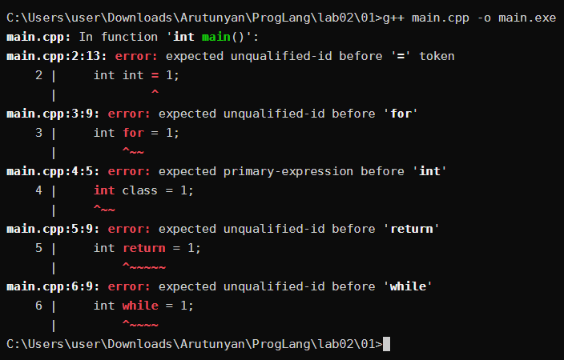

Формулировка `expected unqualified-id` означает, что на месте имени переменной парсер встретил токен, который именем быть не может.

#### Java

Файл [01/Main.java](01/Main.java).

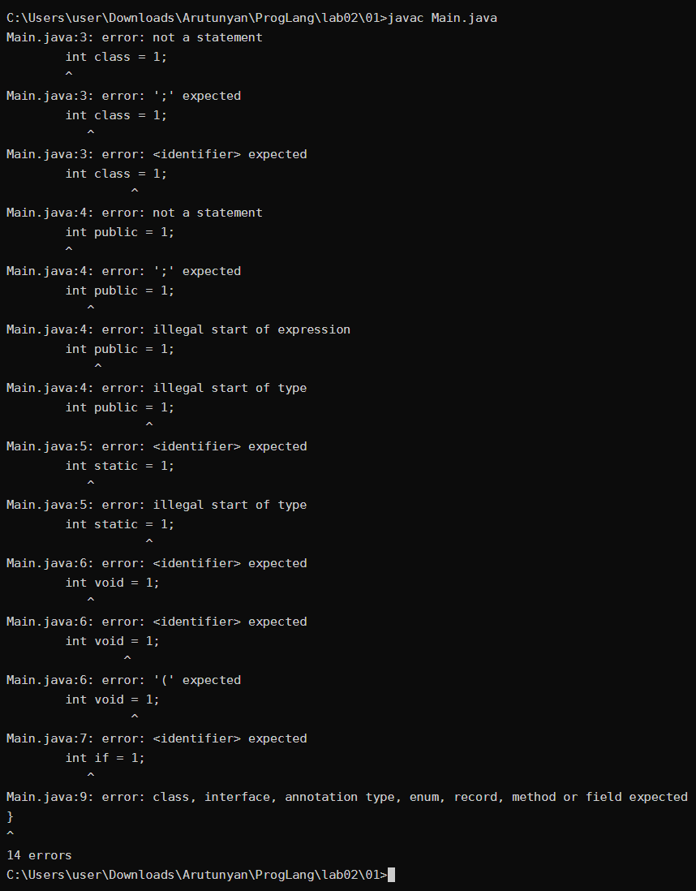

На пять строк получилось 14 ошибок: после первой ошибки `javac` не бросает разбор, а пытается восстановиться и достроить дерево, из-за чего одна строка порождает несколько сообщений (`not a statement`, `';' expected`, `<identifier> expected`).

#### Python

Python транслирует модуль целиком и останавливается на первой же синтаксической ошибке, поэтому проверить пять слов в одном файле «в лоб» не получится. В [01/keywords.py](01/keywords.py) каждое присваивание компилируется отдельно через `exec`, а `SyntaxError` перехватывается.

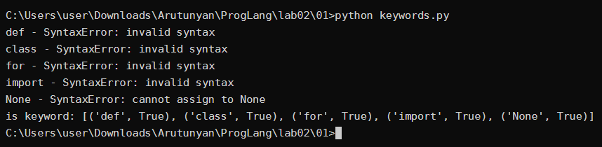

Все пять имён недоступны. Для `None` сообщение другое — `cannot assign to None`: `None` тоже ключевое слово (`keyword.iskeyword('None')` возвращает `True`), но ошибка возникает не при разборе строки, а при генерации кода, когда компилятор видит попытку присвоить значение константе.

### Задание 2


#### C++

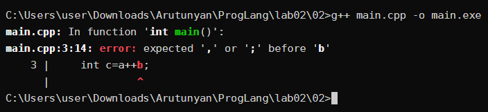

#### Python

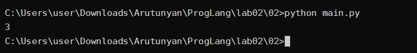

Программа на Python отработала и напечатала `3`.

#### Разбиение на токены

Строка `int c=a++b;` в C++ разбивается на 7 токенов:

```
int   ключевое слово
c     идентификатор
=     оператор
a     идентификатор
++    оператор
b     идентификатор
;     разделитель
```

Строка `c=a++b` в Python — на 6 токенов:

```
c     идентификатор
=     оператор
a     идентификатор
+     оператор
+     оператор
b     идентификатор
```

Разбиение Python на токены можно посмотреть напрямую модулем `tokenize` — два символа `+` действительно дали два отдельных токена `OP`:

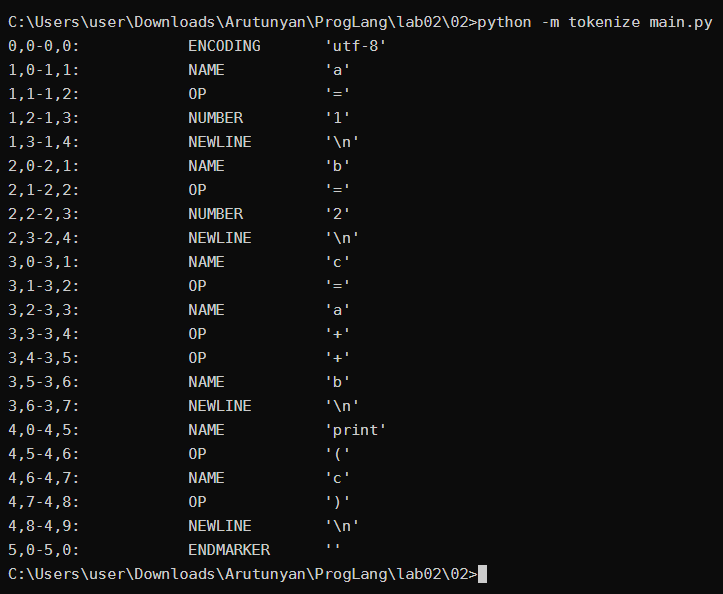

#### Почему C++ не компилируется, а Python работает

Оба лексических анализатора работают по правилу «самого длинного совпадения» (maximal munch): из текущей позиции берётся самая длинная последовательность символов, образующая допустимый токен.

В C++ существует оператор `++`, поэтому из `a++b` лексер выделяет `a`, `++`, `b`. Дальше синтаксический анализатор видит выражение `a++`, за которым сразу идёт `b`, а между двумя операндами нет бинарного оператора — отсюда `expected ',' or ';' before 'b'`. Ошибка синтаксическая, а не лексическая: набор токенов корректен, но они не складываются в правило грамматики.

В Python оператора `++` нет, самый длинный допустимый токен — одиночный `+`. Поэтому получается `a`, `+`, `+`, `b`, что грамматика разбирает как `a + (+b)`: бинарный плюс и унарный плюс. Результат `1 + (+2) = 3`, что и напечатала программа.

### Задание 3

Файл [03/main.cpp](03/main.cpp).

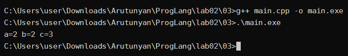

После выполнения `a = 2`, `b = 2`, `c = 3`.

#### Разбиение на токены

Строка `int c=a+++b;` разбивается на 8 токенов:

```
int   ключевое слово
c     идентификатор
=     оператор
a     идентификатор
++    оператор
+     оператор
b     идентификатор
;     разделитель
```

По тому же правилу самого длинного совпадения лексер, дойдя до первого `+`, забирает сразу два символа в токен `++`, а третьему `+` остаётся быть отдельным токеном. Вариант `a + (++b)`, который выглядит не менее осмысленным, лексер не рассматривает: решение принимается по символам, без учёта того, разберёт ли это потом грамматика.

Получается `c = (a++) + b`. Постфиксный инкремент возвращает старое значение `a` (единицу) и увеличивает `a` до 2, поэтому `c = 1 + 2 = 3`, `a = 2`, `b` не меняется.

#### Изменение разбиения пробелами

Пробелы не входят в токены, но они прерывают «самое длинное совпадение», поэтому расстановкой пробелов разбиение менять можно. Проверка в [03/variants.cpp](03/variants.cpp):

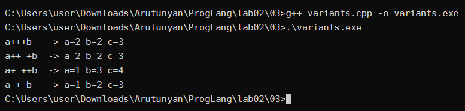

```
запись     токены          результат
a+++b      a ++ + b        a=2 b=2 c=3
a++ +b     a ++ + b        a=2 b=2 c=3
a+ ++b     a + ++ b        a=1 b=3 c=4
a + b      a + b           a=1 b=2 c=3
```

Пробел после `a++` ничего не меняет — токены те же. А пробел после первого `+` заставляет лексер выделить `+` и `++` в другом порядке, и выражение превращается в `a + (++b)`: теперь инкремент предынкрементный и применяется к `b`, поэтому `b = 3` и `c = 4`, а `a` остаётся единицей.

Не всякая расстановка пробелов даёт работающую программу. Запись `a ++ b` ([03/bad.cpp](03/bad.cpp)) даёт токены `a` `++` `b` — ту же ошибку, что и в задании 2:

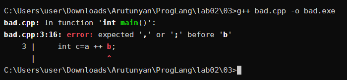

### Задание 4

Круглые скобки являются оператором, когда они стоят после выражения и означают **вызов** — `operator()`. Квадратные скобки являются оператором, когда они стоят после выражения и означают **индексирование** — `operator[]`. Формальный признак: в C++ оператором считается то, что можно перегрузить, и обе эти формы перегружаются.

Скобки **не** являются оператором, когда они часть синтаксиса объявления или конструкции языка:

* круглые скобки для группировки подвыражений — `(a + b) * c`;
* список параметров в объявлении функции — `int add(int x, int y)`;
* скобки в `if (...)`, `while (...)`, `for (...)`, `switch (...)`;
* квадратные скобки в объявлении массива — `int arr[3];` (здесь `[3]` — часть описателя типа, а не операция над `arr`);
* квадратные скобки списка захвата лямбды — `[](){}`.

Проверка в [04/main.cpp](04/main.cpp): в структуре `Table` перегружены `operator()` и `operator[]`, и оба вызываются обычным синтаксисом.

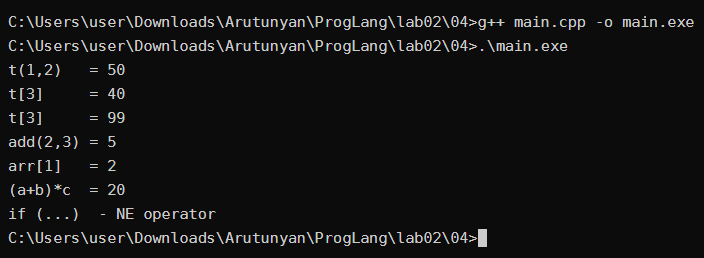

Обратите внимание на `t[3] = 99`: `operator[]` возвращает ссылку, поэтому индексирование даёт не значение, а объект, которому можно присваивать. Для скобок-группировки такое невозможно в принципе — они не порождают никакой операции, а лишь задают порядок разбора.

### Задание 5

Файл [05/main.py](05/main.py):

```python
print(*map(sum,zip(
    *[map(int,input().split()) for i in (1,2,3)]
    )))
```

#### Лексический разбор

**Ключевые слова:** `for`, `in` — оба из генератора списка. Больше ключевых слов в программе нет.

**Идентификаторы:** `print`, `map`, `sum`, `zip`, `int`, `input`, `split`, `i`.

* имена встроенных функций — `print`, `map`, `sum`, `zip`, `input`;
* `int` — имя встроенного типа, используется как функция преобразования;
* `split` — имя метода строки;
* `i` — единственная переменная, счётчик генератора списка.

**Литералы:** `1`, `2`, `3` — целочисленные литералы. Запись `(1,2,3)` литералом не является: это выражение, которое во время выполнения строит кортеж из трёх литералов.

**Операторы:** `*` — распаковка итерируемого объекта в аргументы вызова (не умножение, так как стоит в позиции аргумента); `()` — вызов; `.` — доступ к атрибуту в `input().split()`. Квадратные скобки здесь оператором не являются — они образуют генератор списка, а запятые являются разделителями аргументов.

Разбиение, полученное модулем `tokenize`:

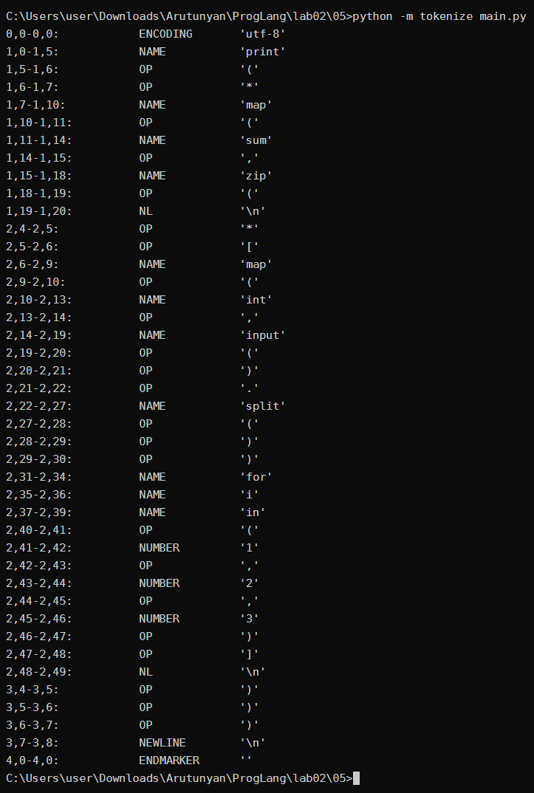

#### Вызовы функций

* `input()` — параметров нет, возвращает строку, прочитанную со стандартного ввода.
* `<str>.split()` — параметров нет, возвращает список подстрок, разделитель — любые пробельные символы.
* `map(int, <список строк>)` — два параметра: функция `int` и итерируемое; возвращает ленивый объект, выдающий числа.
* `zip(m1, m2, m3)` — три объекта `map`, переданные распаковкой `*`; возвращает ленивый объект, выдающий кортежи из соответственных элементов.
* `map(sum, <zip>)` — два параметра: функция `sum` и итерируемое; возвращает ленивый объект, выдающий суммы кортежей.
* `sum(<кортеж>)` — один параметр, кортеж чисел; возвращает сумму. Вызывается не напрямую, а внутри `map`.
* `int(<строка>)` — один параметр, строка; возвращает число. Тоже вызывается внутри `map`.
* `print(*<map>)` — элементы распакованы в отдельные аргументы, печатает их через пробел.

#### Что делает программа

Генератор списка `[... for i in (1,2,3)]` выполняется три раза (переменная `i` в теле не используется, кортеж `(1,2,3)` нужен только чтобы задать три итерации). Каждая итерация читает строку и превращает её в числа — получается список из трёх строк матрицы.

`zip(*rows)` распаковывает эти три строки в отдельные аргументы `zip`, то есть транспонирует матрицу: на выходе кортежи-столбцы. `map(sum, ...)` суммирует каждый столбец, `print(*...)` печатает суммы через пробел.

Итог: программа читает матрицу 3 × N и выводит суммы её столбцов.

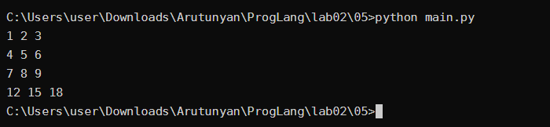

Те же действия по шагам ([05/steps.py](05/steps.py)):

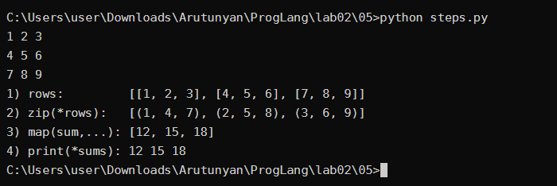

Стоит отметить, что генератор списка вычисляется сразу — три вызова `input()` и `split()` происходят в момент построения списка. А вот `map` и `zip` ленивые: преобразование строк в числа и суммирование откладываются до того момента, когда `print` начнёт запрашивать элементы.

### Задание 6

Комментарии в C++ записываются двумя способами:

* `//` — от двух символов до конца строки;
* `/* ... */` — блочный, от `/*` до ближайшего `*/`, может занимать несколько строк.

Комментарий удаляется на этапе трансляции ещё до синтаксического анализа и заменяется одним пробелом, поэтому для парсера его просто не существует. Вложенных блочных комментариев в C++ нет: первый же `*/` закрывает блок, независимо от того, сколько `/*` встретилось внутри.

#### Пример 1 — верный ([06/c1.cpp](06/c1.cpp))

```cpp
cout<<"Hello /* Это комментарий */ world";
```

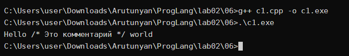

Ошибки нет. Лексер, встретив открывающую кавычку, переходит в режим разбора строкового литерала и до закрывающей кавычки не ищет ни `//`, ни `/*`. Поэтому `/* Это комментарий */` — обычные символы внутри строки, которые печатаются как есть.

#### Пример 2 — ошибка ([06/c2.cpp](06/c2.cpp))

```cpp
// /*
 std::cout << "c2 rabotaet\n";
*/
```

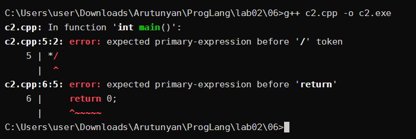

`//` закомментировал всю первую строку вместе с `/*`, так что блочный комментарий не открылся. Строка с `cout` осталась настоящим кодом, а `*/` на третьей строке оказалась непарной последовательностью, которую парсер пытается разобрать как выражение — отсюда `expected primary-expression before '/' token`.

#### Пример 3 — ошибка ([06/c3.cpp](06/c3.cpp))

```cpp
/* Я комментирую программы /* комментарий */ */
```

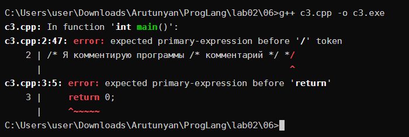

Блочные комментарии не вкладываются. Внутренний `/*` — просто текст внутри комментария, а первый `*/` закрывает блок. Остаётся лишний `*/` в конце строки, который и вызывает ошибку.

#### Пример 4 — верный ([06/c4.cpp](06/c4.cpp))

```cpp
// Я комментирую программы /* комментарий */
```

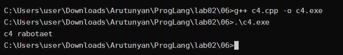

`//` съедает строку целиком, включая `/*` и `*/`. Блочный комментарий не открывается и не закрывается, программа компилируется и работает.

#### Пример 5 — ошибка ([06/c5.cpp](06/c5.cpp))

```cpp
/* Я комментирую свои программы
// Это комментарий до конца строки */
*/
```


Внутри блочного комментария `//` не имеет никакого значения — это обычный текст. Поэтому блок закрывается первым `*/` в конце второй строки, а `*/` на третьей строке остаётся лишним.

Общий вывод: `//` и `/*` не вкладываются друг в друга — работает тот, который начался первым, и всё остальное до конца соответствующего комментария становится текстом. Внутри строкового литерала не работает ни тот, ни другой.

### Задание 7

В стандарте C++17 ([N4659](http://www.open-std.org/jtc1/sc22/wg21/docs/papers/2017/n4659.pdf)), приложение A.5 «Statements», инструкции циклов описаны правилом:

```
iteration-statement:
    while ( condition ) statement
    do statement while ( expression ) ;
    for ( init-statement condition opt ; expression opt ) statement
    for ( for-range-declaration : for-range-initializer ) statement
```

Вспомогательные правила, на которые ссылаются строки выше (там же, A.5):

```
condition:
    expression
    attribute-specifier-seq opt decl-specifier-seq declarator brace-or-equal-initializer

init-statement:
    expression-statement
    simple-declaration

for-range-declaration:
    attribute-specifier-seq opt decl-specifier-seq declarator
    attribute-specifier-seq opt decl-specifier-seq ref-qualifier opt [ identifier-list ]

for-range-initializer:
    expr-or-braced-init-list
```

Индекс `opt` означает, что элемент необязателен.

Как видно из правил, есть **4** инструкции циклов.

#### Первый вид — цикл `while` (цикл с предусловием)

```
while ( condition ) statement
```

* Формат записи (по правилу): ключевое слово `while`, в круглых скобках условие `<condition>`, далее инструкция `<statement>`.
* Условие проверяется **перед** каждым выполнением тела; если оно сразу ложно, тело не выполнится ни разу. По правилу `condition` условие может быть не только выражением, но и объявлением переменной с инициализатором — тогда условием служит значение этой переменной, приведённое к `bool`.

Пример фрагмента программы:

```cpp
int x = 1;
while (x < 1000) {
    cout << x << ' ';
    x *= 2;
}
```

Пример с объявлением в условии:

```cpp
int k = 3;
while (int left = k--)
    cout << "left=" << left << ' ';
```

#### Второй вид — цикл `do ... while` (цикл с постусловием)

```
do statement while ( expression ) ;
```

* Формат записи (по правилу): ключевое слово `do`, далее инструкция `<statement>`, ключевое слово `while`, в круглых скобках выражение `<expression>`, и обязательная точка с запятой `;`.
* Условие проверяется **после** выполнения тела, поэтому тело выполняется хотя бы один раз. Здесь в скобках стоит именно `expression`, а не `condition`, — объявить переменную в условии `do-while` нельзя. Точка с запятой в конце — часть правила, без неё будет синтаксическая ошибка.

Пример фрагмента программы:

```cpp
int n = 0;
do {
    cout << "n=" << n << ' ';
    ++n;
} while (n < 3);
```

#### Третий вид — цикл `for` (классический цикл со счётчиком)

```
for ( init-statement condition opt ; expression opt ) statement
```

* Формат записи (по правилу): ключевое слово `for`, в круглых скобках: инструкция инициализации `<init-statement>`, необязательное условие `<condition>`, точка с запятой, необязательное выражение `<expression>`; далее инструкция `<statement>`.
* `init-statement` выполняется один раз перед циклом, `condition` проверяется перед каждой итерацией, `expression` вычисляется после каждой итерации. Обратите внимание, что между `init-statement` и `condition` в правиле нет `;` — она уже входит в сам `init-statement` (и `expression-statement`, и `simple-declaration` заканчиваются точкой с запятой). Поэтому `init-statement` не помечен как `opt`: даже «пустой» он присутствует в виде одиночной `;`. Если `condition` опущено, оно считается истинным.

Пример фрагмента программы:

```cpp
for (int i = 0; i < 5; ++i)
    cout << i * i << ' ';
```

Другие варианты, которые допускает то же правило. Здесь `init-statement` — выражение, а не объявление:

```cpp
int i;
for (i = 0; i < 3; i++)
    cout << i << ' ';
```

А здесь `init-statement` пустой (одна `;`), а `condition` и `expression` опущены:

```cpp
int s = 0;
for (;;) {
    if (++s == 4) break;
    cout << s << ' ';
}
```

#### Четвёртый вид — цикл `for` по диапазону (range-based for)

```
for ( for-range-declaration : for-range-initializer ) statement
```

* Формат записи (по правилу): ключевое слово `for`, в круглых скобках объявление переменной `<for-range-declaration>`, двоеточие `:`, диапазон `<for-range-initializer>`; далее инструкция `<statement>`.
* Переменная по очереди принимает значения всех элементов диапазона (массива, контейнера, списка инициализации). Вторая строка правила `for-range-declaration` с `[ identifier-list ]` — это структурное связывание (C++17), позволяющее сразу разложить элемент на части.

Пример фрагмента программы:

```cpp
int arr[] = {10, 20, 30};
for (int v : arr)
    cout << v << ' ';
```

С `braced-init-list` в качестве диапазона и со структурным связыванием:

```cpp
for (int v : {7, 8, 9})
    cout << v << ' ';

map<string, int> age = {{"Anna", 20}, {"Oleg", 19}};
for (const auto& [name, a] : age)
    cout << name << ':' << a << ' ';
```

#### Проверка

Все четыре вида в [07/loops.cpp](07/loops.cpp):

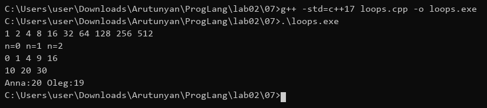

Дополнительные варианты по тем же правилам в [07/variants.cpp](07/variants.cpp):

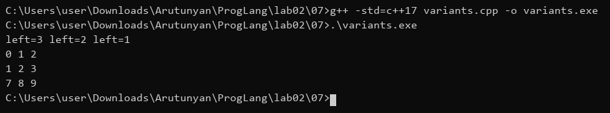


